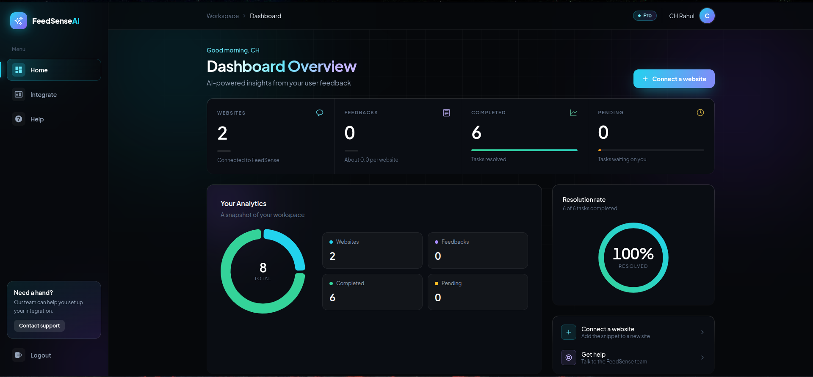

# FeedSenseAI

<p align="center">
  <strong>Turn User Feedback Into Actionable Insights.</strong>
</p>

<p align="center">
  AI-powered feedback analysis that helps you understand users, identify patterns, and make smarter product decisions.
</p>

<p align="center">
  <a href="https://feedsenseai.vercel.app">Live Demo</a> ·
  <a href="https://github.com/Chrahuldeveloper/feedsense.ai">GitHub Repository</a>
</p>

---

## Dashboard Preview



---

## About

FeedSenseAI helps developers, startups, and product teams understand what their users really want.

Instead of manually going through hundreds of feedback submissions, FeedSenseAI uses AI to analyze feedback, identify recurring patterns, and transform user opinions into actionable insights.

Collect feedback, discover problems, and build better products.

## ✨ Features

- **AI-Powered Feedback Analysis** – Automatically analyzes and summarizes user feedback into meaningful insights.
- **Smart Duplicate Detection** – Identify similar feedback submissions and uncover recurring issues.
- **Actionable Insights** – Transform user suggestions, complaints, and ideas into actionable tasks.
- **Customizable Feedback Widget** – Easily integrate feedback collection directly into your website.
- **Centralized Dashboard** – Manage, filter, and prioritize feedback from one place.
- **Multi-Project Support** – Manage feedback across multiple projects.
- **Team Collaboration** – Work together to understand and prioritize user needs.

## 🛠️ Installation

### Prerequisites

- Node.js
- npm
- Git

### Getting Started

Clone the repository:

```bash
git clone https://github.com/Chrahuldeveloper/feedsense.ai.git
```

Navigate into the project:

```bash
cd feedsense.ai
```

Install dependencies:

```bash
npm install
```

Start the development server:

```bash
npm run dev
```

Open `http://localhost:3000` in your browser.

## Why FeedSenseAI?

Great products are built by listening to users.

FeedSenseAI makes that process easier by turning unstructured feedback into insights that help teams prioritize what matters most.

**Listen. Analyze. Improve.**

---
